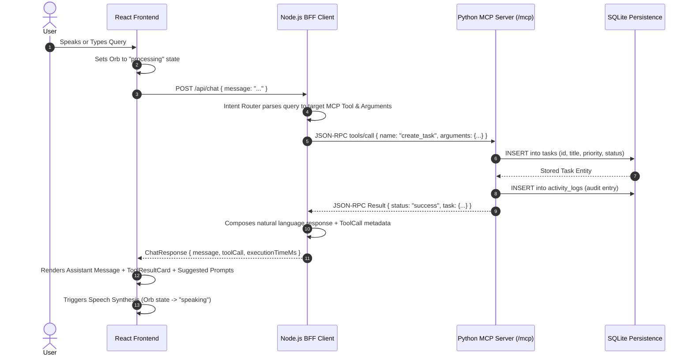

# ASTRA AI — Technical Architecture Specification

**Product Name:** ASTRA AI  
**Tagline:** Your world. One intelligent assistant.  
**Track:** Amazon Build, Ship, Shape — Alexa+ Hackathon Track  

---

## 1. Architectural Overview

ASTRA AI is architected as a high-performance, decoupled three-tier system:

```
┌─────────────────────────────────────────────────────────────┐
│                       React 18 Frontend                     │
│  - Vite + TypeScript + Tailwind CSS                         │
│  - 8 Functional Pages (Landing, Chat, Tools, Tasks, etc.)   │
│  - Luminous Dynamic AI Orb (Idle, Listening, Thinking, Spk) │
│  - Web Speech API (Voice Recognition & Speech Synthesis)    │
└──────────────────────────────┬──────────────────────────────┘
                               │ HTTP / JSON
                               ▼
┌─────────────────────────────────────────────────────────────┐
│                 Node.js / Express BFF Client                │
│  - Official TypeScript MCP SDK (@modelcontextprotocol/sdk)  │
│  - StreamableHTTPClientTransport                            │
│  - Intent Router & Conversational Engine                    │
│  - Transparent Fallbacks & Optional Cloud LLM Adapter       │
└──────────────────────────────┬──────────────────────────────┘
                               │ Streamable HTTP (/mcp)
                               ▼
┌─────────────────────────────────────────────────────────────┐
│                  Python 3.14 FastMCP Server                 │
│  - Official Python MCP SDK (mcp 2.3.0)                      │
│  - StreamableHTTPServerTransport (Specification 2025-11-25) │
│  - 15 Discovered Operational Tools                          │
│  - Safe AST Calculator, Timezones, Weather, Conversions     │
└──────────────────────────────┬──────────────────────────────┘
                               │ SQL Transactions
                               ▼
┌─────────────────────────────────────────────────────────────┐
│                  Persistent SQLite Storage                  │
│  - WAL Mode for High Concurrent Read/Write Throughput       │
│  - Tables: tasks, notes, activity_logs, conversations       │
└─────────────────────────────────────────────────────────────┘
```

---

## 2. Request and Protocol Execution Flow

When a user submits a natural-language query (e.g. *"What is the weather in Seattle?"* or *"Create task: Review MCP spec with high priority"*):



---

## 3. Signature Design Element: The Dynamic AI Orb

The AI Orb is a lightweight CSS/SVG vector energy sphere with four distinct states:

1. **Idle (`idle`):** Calming, harmonic purple-to-indigo radial gradient with a slow 4-second breath cycle.
2. **Listening (`listening`):** Vivid cyan and teal illumination with dynamic concentric ripple wave rings reacting to user speech.
3. **Processing (`processing`):** Plasma ring spin with rapid shimmer indicating remote MCP protocol execution.
4. **Speaking (`speaking`):** Undulating soundwave harmonics with warm lavender glow synchronized with browser speech synthesis.

---

## 4. Multi-Page Structure

1. **Landing Page (`/`):** Hero introduction, interactive Orb demonstration, architecture highlights, and quick starters.
2. **Assistant Page (`/chat`):** Central conversational interface with user/assistant bubbles, voice recording, live tool cards, copy button, and suggestions.
3. **Explore Page (`/explore`):** Categorized capability discovery (Everyday, Productivity, Math, Weather, Notes) with one-click starter prompts.
4. **Tools Directory (`/tools`):** Live MCP tool registry showing discovered tool schemas and an interactive real-time tool tester with execution latency metrics.
5. **Tasks Page (`/tasks`):** Full personal productivity manager with priority badges, status filters, deadline sorting, and completion toggles.
6. **Notes Page (`/notes`):** SQLite-backed markdown knowledge base with real-time keyword search, categories, and tags.
7. **Activity Page (`/activity`):** Audit log of every tool execution and Recharts data visualizations of task completion rates and status distribution.
8. **Settings Page (`/settings`):** Theme toggle (Dark/Light), auto-speech preferences, connection diagnostics, and demo data reset.

---

## 5. Security Architecture

- **No Secret Leakage:** Environment variables are strictly maintained on the server-side (`client-backend` and `mcp-server`). No API keys or tokens are embedded in frontend bundles.
- **Safe Calculator Execution:** Math expressions are parsed strictly through Python's `ast` module against an operator whitelist (no `eval` or arbitrary code execution).
- **Localhost Restricted:** Servers bind to `127.0.0.1` by default to prevent unintended network exposure.
- **Input Validation:** Strict Pydantic models in Python and TypeScript interfaces in Node validate all payloads.

---

## 6. Future Mobile & Android Packaging Path

ASTRA AI is decoupled to enable instant mobile deployment:
1. **Capacitor Integration:** Run `npx cap init astra-ai com.astra.assistant` and `npx cap add android` in the `frontend` folder.
2. **Offline Resilience:** Tasks and notes can be synchronized via local IndexedDB or SQLite sidecars.
3. **Android Voice API:** Standard Android SpeechRecognizer maps 1:1 to our `useSpeech` hook.
